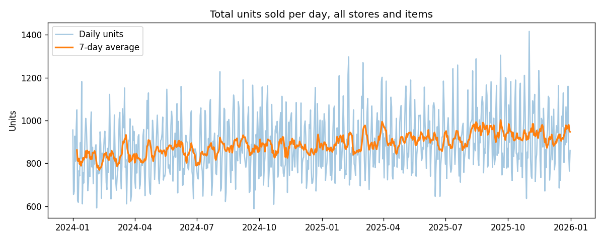
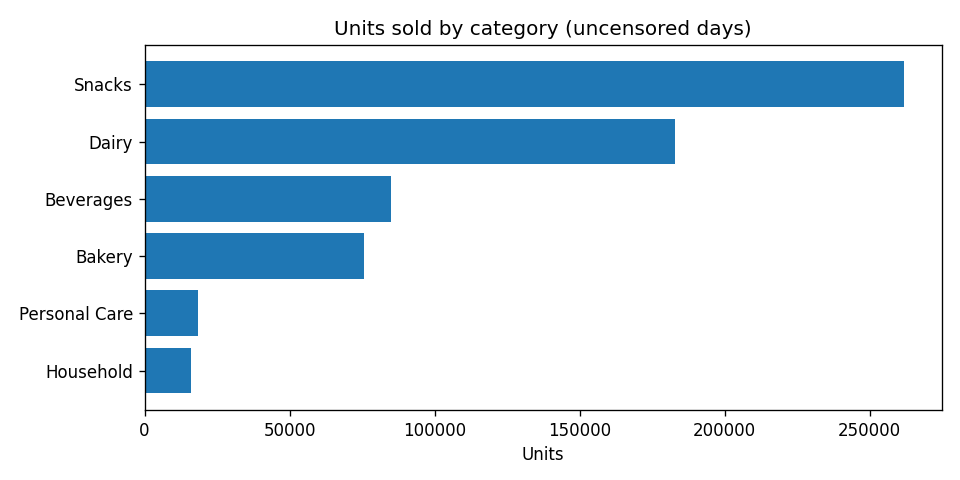
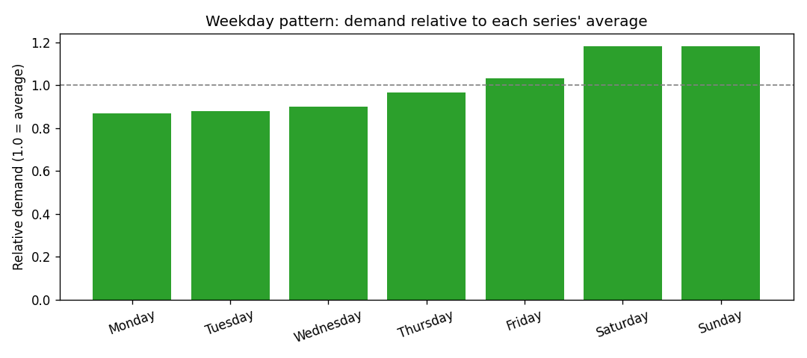
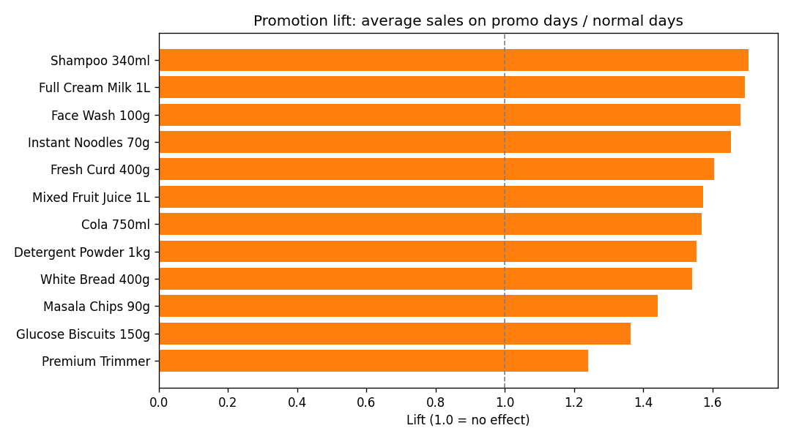
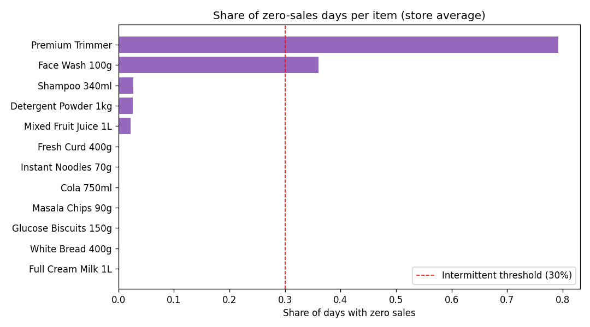
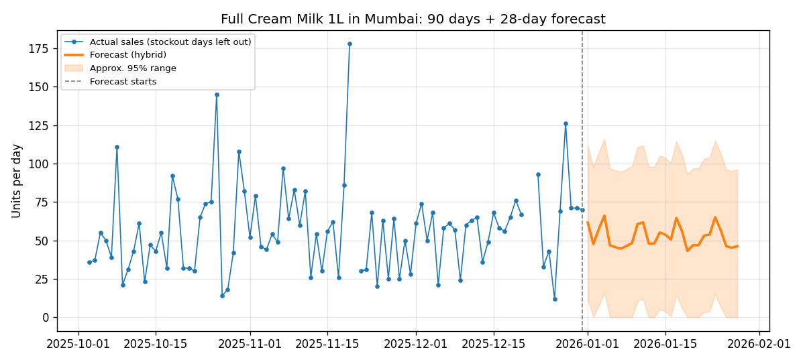
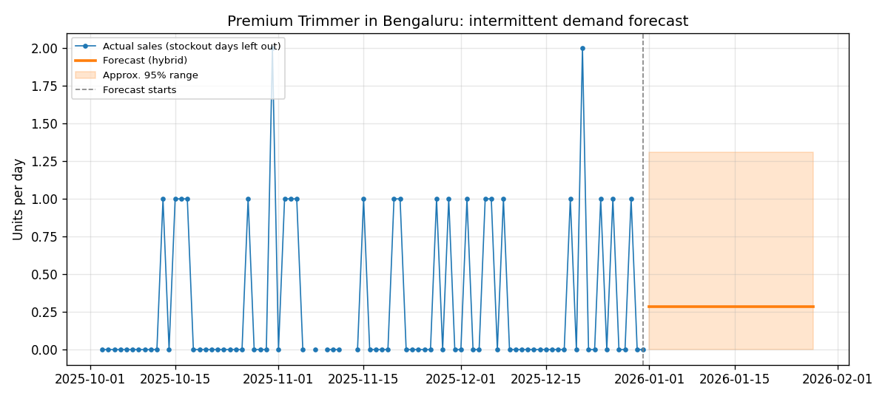
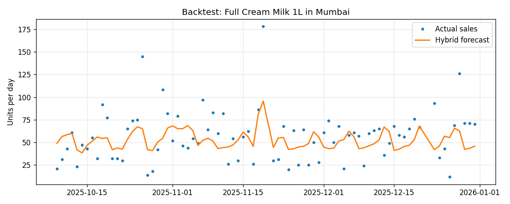
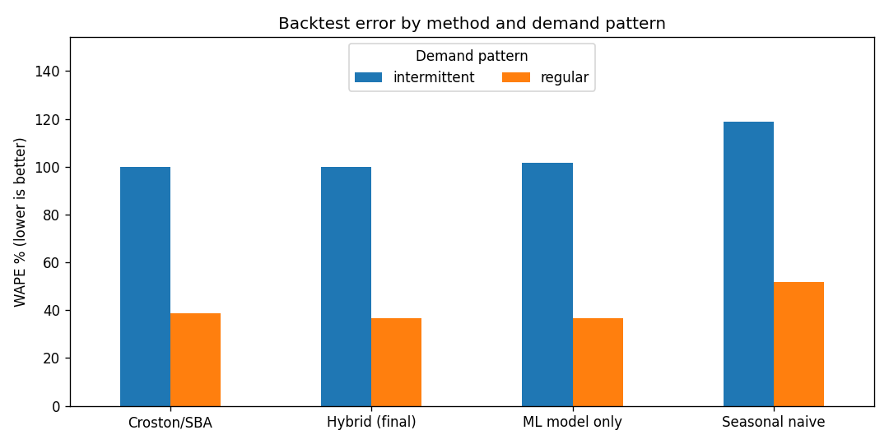
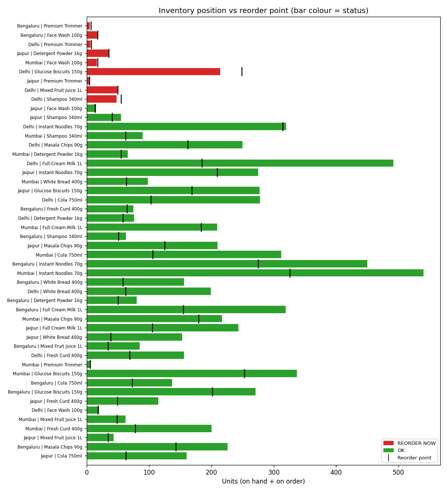

# Retail Sales Forecasting & Inventory Optimization System

An end-to-end data science project that **forecasts daily sales for every store and product**, then turns those forecasts into **stocking decisions**: when to reorder, how much safety stock to hold, and how big each purchase order should be.

> **Data note:** This project uses a **synthetic (simulated) retail dataset** created by the included simulator. It does not use any real company data. The simulator is designed to behave like real point-of-sale data, including stockouts, promotions, festivals and supplier delays.

---

## The idea in one paragraph

Shops can lose money in two ways. If they order too little, shelves run empty and customers buy from a competitor (lost sales). If they order too much, cash is tied up in stock that may expire or gather dust (holding cost). This project learns from past sales to predict what will sell in the next four weeks, and then calculates the **right reorder point and order quantity** for each product in each store. A Streamlit dashboard lets a planner check any product in seconds and export purchase orders.

---

## Results at a glance

All numbers come from rolling-origin backtests (3 past 4-week windows, stockout days excluded). Lower is better for every metric.

| Method | MAE (units/day) | RMSE | MASE | WAPE |
|---|---|---|---|---|
| Seasonal naive (baseline: same weekday last week) | 10.21 | 16.65 | 1.02 | 51.9% |
| Croston/SBA (applied to every series, for comparison) | 7.69 | 12.75 | 0.79 | 39.1% |
| ML model (gradient boosting) | 7.25 | 11.73 | 0.76 | 36.9% |
| **Hybrid (final)** | **7.25** | **11.73** | **0.76** | **36.9%** |

- **Forecast error fell from 51.9% (naive) to 36.9% (final)**, about a 29% reduction in error.
- **Regular items** (42 store-item series): ML model 36.6% WAPE vs. 51.6% for the naive baseline.
- **Intermittent items** (6 store-item series, e.g. premium trimmers): Croston/SBA was slightly better than the ML model (MASE 0.94 vs 0.98). WAPE near 100% is normal here, because daily sales of 0 or 1 unit are very noisy.
- **Inventory decisions for the next 28 days:** 9 of 48 store-item series need an order now. The 9 purchase orders total **INR 242,213**.

---

## Tech stack

I compared three options and chose the **intermediate** one. It is strong enough to show real modelling skill, runs on any laptop with no GPU, and needs no paid services.

| Option | Tools | Difficulty | GPU | Verdict |
|---|---|---|---|---|
| A. Easiest | Excel/CSV, moving averages, spreadsheet reorder formulas | Easy | No | Too basic to stand out |
| **B. Intermediate (chosen)** | **Python, pandas, NumPy, scikit-learn, SciPy, Matplotlib, Streamlit** | Medium | No | Best balance of depth and speed to finish |
| C. Advanced | Prophet/LSTM, MLflow, FastAPI, Docker, cloud deployment | Hard | Helpful | Good later upgrade, too much for a first project |

Models used: seasonal naive, Croston/SBA (for intermittent demand), and a gradient-boosting regressor (`HistGradientBoostingRegressor` with Poisson loss, which suits unit counts).

---

## Architecture

```
  Raw sales data (CSV)
          │
          ▼
  ┌──────────────────────┐
  │ data_quality.py      │  check the schema, remove duplicates,
  │                      │  fix negatives, flag stockout days
  └──────────┬───────────┘
             │
      ┌──────┴────────────────────────┐
      ▼                               ▼
  ┌─────────────┐             ┌───────────────────┐
  │ eda.py      │             │ features.py       │  daily panel (every day filled),
  │ tables and  │             │                   │  lags, rolling stats, calendar,
  │ 5 charts    │             │                   │  promotions, festivals
  └─────────────┘             └─────────┬─────────┘
                                        │
                                        ▼
                              ┌───────────────────┐
                              │ models.py         │  seasonal naive │ Croston/SBA │ ML model
                              │                   │  → hybrid forecast for each series
                              └─────────┬─────────┘
                                        │
                                        ▼
                              ┌───────────────────┐
                              │ evaluation.py     │  rolling-origin backtest, MAE / RMSE /
                              │                   │  MASE / WAPE, forecast error per series
                              └─────────┬─────────┘
                                        │
                                        ▼
                              ┌───────────────────┐
                              │ inventory.py      │  safety stock → reorder point → EOQ
                              │                   │  → order quantity → purchase orders
                              └─────────┬─────────┘
                                        │
                  ┌─────────────────────┼──────────────────────┐
                  ▼                     ▼                      ▼
           outputs/ (CSV)        images/ (charts)      app/app.py (dashboard)
                                 reports/ (Markdown)
```

### Module guide

| File | What it does | Key output |
|---|---|---|
| `config.py` | Every setting in one place: horizon, service levels, costs, paths | Change behaviour without touching code |
| `src/simulate_data.py` | Creates the synthetic stores, items and daily sales | `data/raw/*.csv` |
| `src/data_quality.py` | Validates and cleans the raw data; writes a quality report | Clean sales table |
| `src/eda.py` | Summary table and five EDA charts | `outputs/eda_item_summary.csv`, `images/01–05` |
| `src/features.py` | Builds the daily panel and model features; prevents data leakage | Feature table |
| `src/models.py` | Seasonal naive, Croston/SBA, gradient boosting, hybrid logic | Forecasts for 28 days |
| `src/evaluation.py` | Rolling-origin backtests and accuracy metrics | `outputs/backtest_*.csv` |
| `src/inventory.py` | Safety stock, reorder point, EOQ, order quantity, PO export | `outputs/replenishment_recommendations.csv`, `po_export.csv` |
| `src/visualize.py` | Forecast, backtest, comparison and reorder charts | `images/06–10` |
| `src/reports.py` | Markdown reports | `reports/*.md` |
| `app/app.py` | Streamlit dashboard for planners | Interactive web page |
| `main.py` | Runs everything in order | One command |
| `tests/` | 16 tests for formulas, features, data and forecasting logic | Confidence the code is right |

### Data flow in one line

`raw CSV → clean → daily panel → features → forecasts (per series) → backtest scores → safety stock & reorder point → orders → charts, reports and dashboard`

---

## Project structure

```
Retail-Sales-Forecasting-Inventory-Optimization/
│
├── data/
│   ├── raw/                      # synthetic sales, item and store master tables
│   └── processed/                # reserved for cleaned exports (kept empty)
├── src/                          # all reusable project logic
│   ├── __init__.py
│   ├── simulate_data.py          # creates the synthetic dataset
│   ├── data_quality.py           # validation and cleaning
│   ├── eda.py                    # exploratory analysis
│   ├── features.py               # daily panel and features
│   ├── models.py                 # forecasting methods and hybrid
│   ├── evaluation.py             # backtesting and metrics
│   ├── inventory.py              # safety stock, ROP, EOQ, orders
│   ├── visualize.py              # charts
│   └── reports.py                # Markdown reports
├── app/
│   └── app.py                    # Streamlit dashboard
├── models/                       # saved model (created by main.py, not committed)
├── outputs/                      # CSV results: forecasts, recommendations, POs, metrics
├── images/                       # charts for this README
│   └── screenshots/              # proof images: terminal, code, tables (see its README)
├── reports/                      # data quality and model summary (Markdown)
├── docs/                         # guides: simulation, GitHub, interviews, troubleshooting
├── scripts/                      # make_screenshots.py: rebuilds the proof images
├── tests/                        # automated tests
├── config.py                     # all settings
├── main.py                       # run the whole project
├── requirements.txt              # Python libraries
├── .gitignore                    # files Git should ignore
└── README.md                     # this file
```

Why the folders are split this way: data, code, outputs and documentation are kept apart, so a recruiter can find the code, the results and the explanation in seconds. Notebooks are not used, so the project runs as normal Python code that anyone can test.

---

## Dataset (synthetic)

`data/raw/retail_sales_daily.csv` has **35,088 rows**: 4 stores × 12 items × 731 days (1 Jan 2024 to 31 Dec 2025).

| Column | Meaning |
|---|---|
| `date` | Calendar day |
| `store_id`, `store_city` | Store (Mumbai, Delhi, Bengaluru, Jaipur) |
| `item_id`, `item_name`, `category` | Product and its category (6 categories, 12 items) |
| `qty_sold` | Units sold that day (what the shop recorded) |
| `price`, `discount_pct`, `on_promo` | Selling price, discount and promotion flag |
| `holiday_flag` | 1 on festival days |
| `footfall_index` | Customer traffic index for the store that day |
| `stock_on_hand`, `on_order` | Shelf stock and stock on the way at end of day |
| `stockout_flag` | 1 if customers wanted more than was on the shelf (true demand is hidden) |

`items_master.csv` adds unit cost, brand, shelf life and **supplier lead time**. `stores_master.csv` adds cluster and footfall level.

**Built-in patterns the models must learn:** weekend peaks, summer drinks peak, festive snack peak, festival spikes, 8% yearly growth, 3-day promotions (10–25% off), 4% price rise in 2025, and random demand noise. Overall stockout rate: **2.85%** of store-item-days.

For how each pattern is generated, see [docs/SIMULATION.md](docs/SIMULATION.md).

---

## Installation

You need **Python 3.10 or newer**. This project was built and tested with Python 3.12.

### Windows (Command Prompt or PowerShell)

```powershell
cd Retail-Sales-Forecasting-Inventory-Optimization
python -m venv .venv
.venv\Scripts\activate
python -m pip install --upgrade pip
pip install -r requirements.txt
python -c "import pandas, sklearn, streamlit; print('Installed OK')"
```

### Mac / Linux

```bash
cd Retail-Sales-Forecasting-Inventory-Optimization
python3 -m venv .venv
source .venv/bin/activate
python -m pip install --upgrade pip
pip install -r requirements.txt
python -c "import pandas, sklearn, streamlit; print('Installed OK')"
```

If activation is blocked on Windows PowerShell, see [docs/TROUBLESHOOTING.md](docs/TROUBLESHOOTING.md).

To create the `requirements.txt` file yourself from an existing environment: `pip freeze > requirements.txt`.

---

## How to run

From the project folder, with the virtual environment active:

```bash
# 1. Run the whole pipeline (about 30–60 seconds)
python main.py

# 2. (Optional) Create a brand-new synthetic dataset first
python main.py --regenerate

# 3. Run the tests
python -m pytest            # or: python tests/run_tests.py

# 4. Open the dashboard
streamlit run app/app.py
```

The dashboard opens at `http://localhost:8501`.

### Sample terminal output

```
[0] Creating synthetic retail dataset ...
Saved 35,088 sales rows to data/raw/retail_sales_daily.csv
[1] Loading, validating and cleaning raw data ...
    35,088 clean rows across 48 store-item series
[2] Exploratory data analysis ...
[3] Building the daily panel ...
[4] Rolling-origin backtest (3 folds x 28 days) ...
[5] Training the final model ...
[6] Forecasting the next 28 days ...
[7] Inventory policy ...
[8] Charts and reports ...

Backtest accuracy (overall, lower is better):
        method    MAE   RMSE  MASE  WAPE_pct
   Croston/SBA  7.689 12.748 0.790    39.080
Hybrid (final)  7.252 11.726 0.756    36.857
 ML model only  7.253 11.726 0.762    36.864
Seasonal naive 10.210 16.654 1.018    51.891

Inventory status:
status
OK             39
REORDER NOW     9

Done in 35 s. See outputs/, images/ and reports/.
```

### What success looks like

- The terminal ends with `Done in ... s` and no red error text.
- `outputs/` contains 7 CSV files, `images/` contains 10 charts, and `reports/` contains 2 Markdown reports.
- `python -m pytest` reports 16 passed.
- The dashboard shows a store and item, a status message, a chart, and a CSV download button.

### Files created

| File | Contents |
|---|---|
| `outputs/forecasts_next_28_days.csv` | Forecast per store, item and day, with each method's prediction |
| `outputs/replenishment_recommendations.csv` | Stock position, safety stock, reorder point, EOQ and order quantity per series |
| `outputs/po_export.csv` | Purchase orders to raise, with order value and expected arrival date |
| `outputs/backtest_metrics.csv` | Accuracy of each method, overall, by pattern and by category |
| `outputs/backtest_predictions.csv` | Every backtest prediction next to the actual sales |
| `outputs/residual_stats.csv` | Typical daily forecast error per series (feeds safety stock) |
| `outputs/eda_item_summary.csv` | Per-item averages, zero-day share and promotion lift |
| `reports/data_quality_report.md`, `reports/model_summary.md` | Readable summaries |

---

## Methodology

### 1. Cleaning

Duplicates are removed, negative quantities are set to zero, and missing values are filled where that makes sense. **Stockout days are not treated as zero sales.** On a stockout day the shop sold only what was left, so true demand is hidden. Those days are excluded when training and when scoring.

### 2. Daily panel

Every store-item series is extended to a complete calendar. A missing day counts as a missing day, not as the next day, so "7 days ago" always means 7 days ago.

### 3. Features (no leakage)

Each day's features use only earlier days: lags (1, 7, 14, 28 days), rolling averages and spread over the previous 7, 14 and 28 days, weekday, week of year, month, weekend flag, festival flag, promotion flag, discount and price. Leakage (using information from the future) is the most common mistake in forecasting. A test in `tests/test_features.py` checks for it.

### 4. Forecasting: a hybrid of three methods

- **Seasonal naive** uses the same weekday last week. It is the baseline any model must beat.
- **Croston/SBA** is designed for intermittent demand. It forecasts *average sale size ÷ average gap between sales*, then applies the Syntetos-Boylan correction.
- **Gradient-boosting model** learns one model across all series, using the features above. It forecasts 28 days ahead one day at a time, feeding each predicted day back in as the next day's history.

**Hybrid rule:** a series with more than 30% zero-sales days in the last 90 is *intermittent* and uses Croston/SBA. All other series use the gradient-boosting model.

> **Honest note on the blend.** The specification suggested blending the ML model with seasonal naive. I tested a 70/30 blend. It was **less accurate** than the ML model alone (38.2% vs 36.6% WAPE on regular items), so the final setting uses the ML model alone. You can test the blend yourself with `ML_WEIGHT = 0.7` in `config.py`. Because this choice used the same backtest folds, a stricter study would hold out a separate time period.

### 5. Backtesting

Three rolling origins are used. At each one, the model is trained only on data available then, forecasts 28 days, and is scored against the real sales on non-stockout days. This copies how the system would really be used.

### 6. Metrics

| Metric | Meaning | Why it is used |
|---|---|---|
| MAE | Average units missed per day | Easy to explain to a planner |
| RMSE | Like MAE, but big misses count more | Shows whether occasional large misses hurt |
| MASE | Error divided by the error of a naive forecast | Scale-free: below 1.0 means better than naive |
| WAPE | Total absolute error ÷ total actual units | A percentage that works across items of different size |

R² was not used. On count data with trend and seasonality it can look high even when day-to-day forecasts are poor.

### 7. Inventory policy

For each store-item series:

| Step | Formula | Worked example: Delhi, Glucose Biscuits 150g |
|---|---|---|
| Expected demand during lead time | μL = sum of the next L forecasts | L = 4 days → μL = 188.13 units |
| Safety stock | SS = z × σ × √L | z = 1.645 (95%), σ = 18.40 → SS = 60.54 |
| Reorder point | ROP = μL + SS | 188.13 + 60.54 = **248.67** |
| Economic order quantity | EOQ = √(2·D·K / H) | D = 41.07 × 365 ≈ 14,990; K = 500; H = 17 × 0.20 = 3.40 → EOQ ≈ **2,100** |
| Order-up-to level | S = ROP + EOQ | 248.67 + 2,099.7 = 2,348.37 |
| Position | on hand + on order | 214 + 0 = 214 |
| Decision | order if position ≤ ROP | 214 ≤ 248.67 → **order ⌈2,348.37 − 214⌉ = 2,135 units** |

This matches the value in `outputs/replenishment_recommendations.csv`. The order-up-to approach is a standard "(s, S)" policy used in practice.

Service levels are set by category: Dairy and Bakery 98%, Snacks and Beverages 95%, Household 92%, Personal Care 90%. These are settings in `config.py`.

---

## Dashboard

`streamlit run app/app.py` opens a planner view with:

- a **store and item selector**
- four metric cards: on hand, reorder point, safety stock, recommended order
- a **status message**: reorder now, overstock risk, or healthy
- a chart of the last 90 days of sales next to the 28-day forecast
- a **filterable table** of all stocking recommendations
- a **CSV download** button

The dashboard only reads the files produced by `main.py`, so it opens instantly.

---

## Charts

Generated by `python main.py` and saved in `images/`:

| Chart | What it shows |
|---|---|
|  | Total daily sales with a 7-day average |
|  | Units sold by category |
|  | Demand by weekday, relative to each item's average |
|  | How much each item's sales rise on promotion |
|  | Share of zero-sales days per item |
|  | Milk: 90 days of history and the 28-day forecast |
|  | Premium trimmer: forecast for intermittent demand |
|  | Backtest: predictions against actual sales |
|  | Error by method and demand pattern |
|  | Inventory position against reorder point for every series |

<!-- After you capture the dashboard, add this line:

-->

---

## Screenshots

Terminal output and source code, rendered from the real run and the real files. The full set and the index are in [images/screenshots/](images/screenshots/).


---

## Limitations (stated honestly)

- **Synthetic data.** The accuracy figures describe the simulated patterns, not a real retailer. Real data would be messier and would need more work.
- **Daily noise sets a floor on error.** Day-to-day sales are random, so even a perfect model would miss by a meaningful amount at item level. Weekly forecasts would likely be more accurate and are a natural next step (not yet tested).
- **Promotions are assumed known in advance,** as they would be when marketing plans them. The final forecast assumes no promotions because no plan exists yet.
- **Shelf life is not used yet.** Large EOQ orders for long-shelf-life items are fine. For perishable items, the order size should also be capped by shelf life.
- **Few intermittent series.** Only 6 of 48 series are intermittent, so conclusions about intermittent demand are less certain.
- **The ML model is not tuned.** Hyperparameters were set sensibly, not searched.
- **Single warehouse, single supplier per item.** Multi-echelon inventory is not modelled.

---

## Future improvements

Ideas in order of difficulty, each a good next step:

1. **Weekly forecasts** for intermittent items, which usually gives much better accuracy.
2. **Shelf-life-aware ordering** for perishables (dairy, bakery).
3. **Price elasticity:** model how demand responds to price changes, not only to promotions.
4. **Weather and local events** as extra features.
5. **Anomaly detection** to flag unusual sales spikes or drops (possible data errors or local events).
6. **Automated replenishment:** run the nightly job and email the purchase order file.
7. **A FastAPI endpoint:** `POST /replenishment` with store, item and stock, returning the forecast and order quantity.
8. **MLflow tracking** to record each model run and compare accuracy over time.
9. **Real-time dashboard** fed by a database instead of CSV files.
10. **ERP integration** with the purchasing system that raises purchase orders.

---

## Learning outcomes

By building this project you practise:

- Time-series thinking: calendars, lags, leakage and backtesting
- Handling censored (hidden) data, which is common in real retail systems
- Choosing a forecasting method per demand pattern, not one model for everything
- Turning a forecast into a business decision with safety stock, reorder points and EOQ
- Writing modular, tested Python with a clear configuration file
- Presenting results with metrics, charts, a dashboard and clear documentation

---

## Documentation

| Guide | What is in it |
|---|---|
| [docs/SIMULATION.md](docs/SIMULATION.md) | How the synthetic data is created, step by step, with the proof to capture |
| [docs/GITHUB_GUIDE.md](docs/GITHUB_GUIDE.md) | Publishing to GitHub, commit messages, an 8-day build plan, screenshots |
| [docs/INTERVIEW_PREP.md](docs/INTERVIEW_PREP.md) | Resume bullets, LinkedIn text, interview questions with answers |
| [docs/TROUBLESHOOTING.md](docs/TROUBLESHOOTING.md) | Common errors and fixes for installation, data, models, plots and Git |

---

## Author

**[Your Name]**
Student, [Your Course / College]
[LinkedIn](https://linkedin.com/in/your-profile) · [Email](mailto:you@example.com)

*Replace the placeholders above before publishing.*
